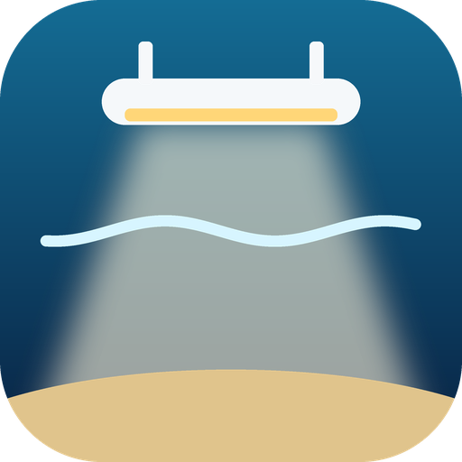
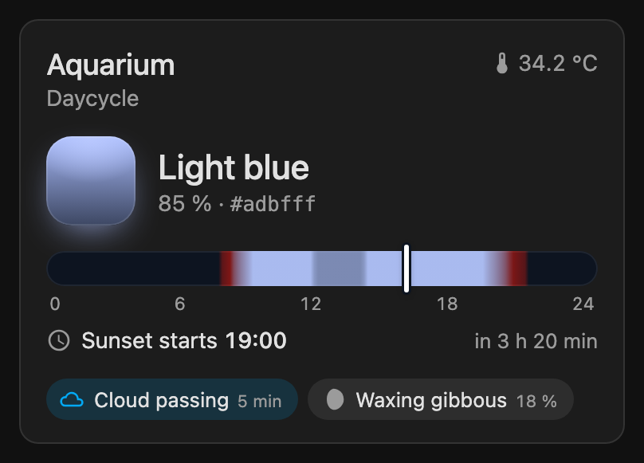
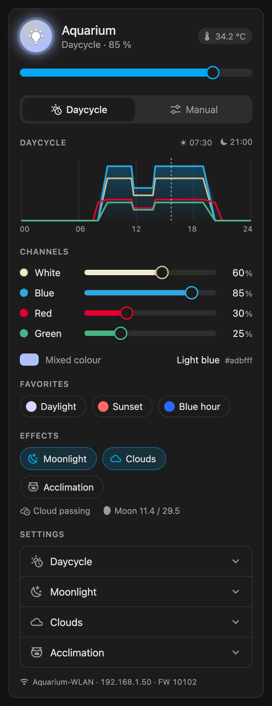

<p align="center">
  
</p>

# daytime Smart Control SC25 for Home Assistant

[](https://hacs.xyz)
[](https://github.com/martinjuhasz/ha-daytime-sc25/actions/workflows/validate.yml)
[](https://github.com/martinjuhasz/ha-daytime-sc25/actions/workflows/tests.yml)

Local control of the **daytime Smart Control SC25** aquarium light controller
(onex, matrix, pendix …) from Home Assistant — no cloud. The integration talks to
the controller's own WebSocket API, keeps a persistent connection and ships two
dashboard cards.

<p align="center">
  
  &nbsp;
  
</p>

> **Not affiliated with daytime / aquaLEDs.** The protocol was reverse
> engineered from the controller's web app; see [docs/protocol.md](docs/protocol.md).
> Use at your own risk.

## Features

- **Light**: the whole lamp (dimming keeps the colour mix) and one light per
  colour channel (white, blue, red, green — as many as your lamp uses).
- **Mode**: daycycle or manual. Optionally return to the daycycle automatically
  after a manual change — handled by the controller itself.
- **Colour favourites**: the controller's 10 favourite slots, applied with a select
  and saved/deleted with services.
- **Daycycle**: day start/end, sunrise/sunset duration, brightness, brightness
  per colour, midday dimming, sunrise/sunset glow. The curve is computed exactly
  like the vendor app does. Free-form curves via a service, fast-motion preview.
- **Effects**: moonlight (phases, colours, times), clouds (probability, count,
  strength, duration), acclimation (days, reduction, pause).
- **Status**: live output per channel, module temperature, cloud passing and next
  cloud, moon phase, acclimation progress, Wi-Fi network and IP, firmware update
  notice.
- **Two cards**, loaded automatically — no resource to add.

## Requirements

- Home Assistant **2026.10** or newer.
- An SC25 reachable from Home Assistant (TCP port 80). Tested with firmware **10102**.

## Installation

### HACS (recommended)

1. Open HACS, search for **daytime Smart Control SC25** and install it.
2. Restart Home Assistant.

If the search finds nothing, add the repository first: HACS → ⋮ → *Custom
repositories* → `https://github.com/martinjuhasz/ha-daytime-sc25` with type
**Integration**.

### Manual

Copy `custom_components/daytime_sc25` into `<config>/custom_components/` and
restart Home Assistant.

## Setup

*Settings → Devices & services → Add integration → daytime Smart Control SC25*
and enter the controller's IP address or host name.

**Options** (gear icon on the integration): *Return to daycycle after a manual
change* in minutes. `0` (default) keeps manual mode until you switch back.

> The SC25 has no authentication. Anyone on your network can control it — keep it
> on a trusted network or VLAN.

## Cards

### Info card

```yaml
type: custom:daytime-sc25-info-card
entity: light.sc25_12345678
name: Aquarium        # optional
```

Shows the current mixed colour (and the scheduled one if it differs), a **24 h
light band** with the planned colour and brightness over the day, the next event
(“Sunset starts 20:00 · in 7 h”), active effects as chips and hints such as
expert mode or an available firmware update. In manual mode the band shows the
plan dimmed and the manual colour until the automatic return (or the end of the
day).

### Control card

```yaml
type: custom:daytime-sc25-card
entity: light.sc25_12345678
name: Aquarium        # optional
settings: false       # optional: hide the settings sections
```

Lamp and colour sliders with the mixed colour, mode switch, daycycle graph,
favourites, effects and collapsible settings for daycycle, moonlight, clouds and
acclimation. Wi-Fi, IP and firmware are shown at the bottom.

All other entities are found through the lamp's device. Any of them can be
overridden in the card config: `mode`, `white`, `blue`, `red`, `green`,
`moonlight`, `clouds`, `acclimation`, `temperature`, `favorite`.

The **mixed colour** adds the LED colours like light mixes in the tank and is
normalised to the brightest component; the brightness is shown separately. LED
colours are approximations, not measurements.

## Entities

| Entity | Purpose |
|---|---|
| `light.<name>` | Whole lamp; brightness scales all channels and keeps the mix |
| `light.<name>_white` / `_blue` / `_red` / `_green` | Single colour channels |
| `select.<name>_mode` | Daycycle / manual; attributes: curve, settings, scheduled levels now, time until automatic return |
| `select.<name>_favorite` | Apply a colour favourite (switches to manual) |
| `switch.<name>_moonlight` / `_clouds` | Effects on/off |
| `button.<name>_preview_daycycle` | Fast-motion preview, then back to the previous mode |
| `sensor.<name>_output_*` | Actual output per channel, including effects |
| `sensor.<name>_module_temperature` | Module temperature |
| `binary_sensor.<name>_cloud_passing` | A cloud is passing (attributes: remaining time, light level) |
| `sensor.<name>_next_cloud` | Start of the next cloud |
| `sensor.<name>_moon_phase_day` / `_moonlight_level` | Moon phase (day of 29.5) and current moonlight level |
| `sensor.<name>_acclimation_day` / `_acclimation_level` | Acclimation day and today's brightness (100 % when off) |
| `sensor.<name>_wi_fi` | Wi-Fi network; attributes: IP address, DHCP |
| `update.<name>_firmware` | Installed and available firmware (installing is not supported — use the web app) |

Configuration entities (device page → *Configuration*):

| Area | Entities |
|---|---|
| Daycycle | day start/end, sunrise/sunset duration, day brightness, brightness per colour, midday dimming (start, end, brightness), sunrise/sunset glow (duration, strength 0–5) |
| Moonlight | full/new moon brightness, moon phases, colours per channel, custom times (start, end) |
| Clouds | probability, max per day, strength min/max, duration min/max |
| Acclimation | on/off, pause, duration, reduction, current day |
| Device | controller name, sync clock |

Changing a daycycle setting rebuilds the curve from the easy-mode settings. A
curve edited point by point (expert mode) is replaced — the info card warns when
expert mode is active.

## Services

| Service | Purpose |
|---|---|
| `daytime_sc25.save_favorite` | Store `channels: [w, b, r, g]` (default: current output) as `name` in `slot` 1–10 |
| `daytime_sc25.delete_favorite` | Empty a favourite slot |
| `daytime_sc25.set_daycycle_curve` | Write a free-form curve: `points: [[0,0,0,0,0], [540,100,80,60,40], …, [1440,0,0,0,0]]` |
| `daytime_sc25.preview_daycycle` | Preview with custom `seconds`, `start`, `end` |

Target one of the two select entities (`select.<name>_mode` or `_favorite`).

```yaml
action: daytime_sc25.save_favorite
target:
  entity_id: select.sc25_12345678_favorite
data:
  slot: 1
  name: Evening
  channels: [40, 10, 90, 5]
```

## Not supported on purpose

Wi-Fi / access point setup, pairing several controllers, factory reset and
firmware installation. A mistake there can leave the controller unreachable;
use the vendor web app for these.

## Troubleshooting

Enable debug logging to see every WebSocket frame:

```yaml
logger:
  logs:
    custom_components.daytime_sc25: debug
```

The integration never logs or stores the Wi-Fi or access-point password.

## Development

```bash
python3 -m venv .venv && . .venv/bin/activate
pip install -r requirements_test.txt
ruff check . && ruff format --check .
pytest                                            # offline, against tests/fake_sc25.py
SC25_HOST=192.168.1.50 pytest tests/test_live.py  # against a real controller
```

`tests/fake_sc25.py` is a stand-in controller that reproduces the observed device
behaviour (state burst on connect, broadcast to all clients, the delayed stale
`CCV` after a mode change). The live test changes the real device and restores
its configuration at the end. See [CONTRIBUTING.md](CONTRIBUTING.md).

## Credits

The SC20 protocol notes by [dc0sk/daytime](https://github.com/dc0sk/daytime) were
a valuable starting point.

## License

[MIT](LICENSE)
